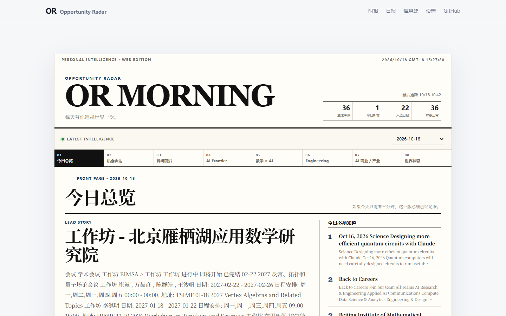
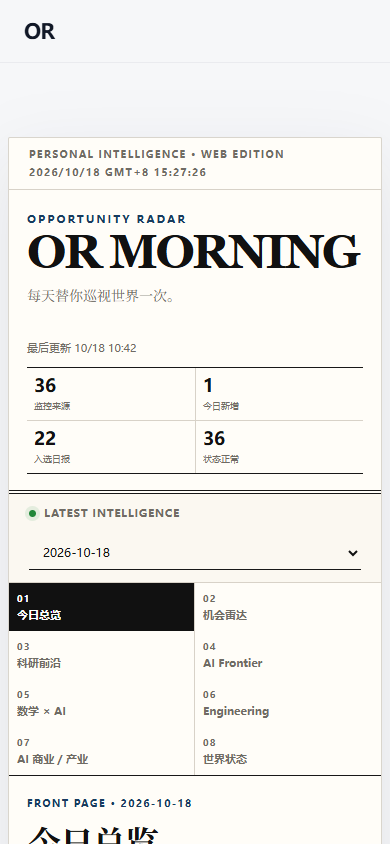

# OR Morning 设计基线审计

日期：2026-10-18。基线提交：`775f3d5298b207412e179ccf50de15096658f13a`。
范围：真实 `docs/` 静态站点；首页、八个时报版面、日期、归档、来源分组、设置、未连接管理页。
目标：让读者快速找到相关信息及原始出处，改善连续阅读、移动访问和键盘操作。Awwwards / Webby / FWA 仅作为体验品质参照，不是获奖或认证声明。

## 架构与保留契约（代码确认）

- `docs/index.html` + `styles.css` + `app.js`：指标、日报档案、来源、设置。
- `docs/newspaper.js` + `newspaper.css`：日报 v2 的八版阅读，旧 v2 内容兼容和 5 分钟轮询。
- `docs/admin.*`：读取 runtime URL，通过内存中的 token 调用 Registry GET/PUT。
- `docs/data/reports.json`：61 个日期；最新为 2026-10-18。latest metrics 为 36 来源、36 正常、1 新增、22 入选。
- JSON schema v2 是真实内容；`newspaper.pages` 优先，`digest.groups` 是兼容路径。完整源码数据、分类词、排序、DeepSeek 处理不在本次设计修改范围。
- `scripts/build_site_data.py` 只将存在的 JSON/MD/TEX/PDF 加入 manifest；当前最新日期没有 PDF。
- Python 抓取 → 去重 → 两级编辑 → 日报产物 → Actions → Pages 上传 `docs/`。不需要 Node 服务。
- 当前 `registry_api_url=null`。首页不提供管理 CTA，后台不能连接或保存。
- 基线 `pytest -q`：24 passed，1.26s。初始工作树干净，已建立 `design/or-morning-upgrade` 分支。

## 截图确认的问题

| 严重度 | 发现与用户影响 | 证据 | 处理方向 |
|---|---|---|---|
| P1 | <=860px 主导航被隐藏，手机不能通过导航进入日报、来源、设置 | `before/home-390.png`、`home-768.png`；styles.css 的 media rule | 始终可见的四入口导航 |
| P1 | 390px 视口的首条标题位于 960px，320px 位于 1004px，首屏没有实际信息 | `before/capture.json` 与首页截图 | 压缩运营状态和重复标题，移动状态可展开 |
| P2 | 243 个可见文本节点小于 12px，版签、摘要、来源与标签普遍 9–11px | `before/capture.json`；newspaper.css | 元信息 >=12px，正文 15–16px |
| P2 | 桌面 01 栏目标题与刊头竞争，正文很晚开始；副栏摘要过小且直接截断 | `before/home-1440.png` | 降低重复栏目标题，展开式摘要 |
| P2 | 信息源和设置使用大圆角/阴影卡片，报纸使用直角与细线，视觉语言不统一 | `before/sources-1440.png` | 共享纸白、墨绿、细线与控制状态 |
| P2 | 窄屏管理页标题断成孤字，主导航也消失 | `before/admin-320.png` | 平衡标题断行、保留返回入口 |
| P2 | 8 个手机版签占四行，选中态清楚但占用大量首屏高度 | `before/home-320.png` | 可横滑、可方向键访问的完整标签 |

## 代码确认的交互风险

- tabs 只有 `role=tab` 和 selected，没有 roving tabindex、方向键、tabpanel 关联；重建 DOM 会丢失焦点。
- loadJson 用空数组作为网络错误的 fallback，会将失败显示为“没有日报”。读取失败时 loading 状态不清除。
- 日期请求没有顺序控制，快速切换可能让旧响应覆盖新日期。
- 每次更新日期下拉框都重复绑定 change listener。定时重绘还会关闭读者展开内容。
- 分版 `items.slice(1,7)` 在更多条目时丢失显示内容。
- 管理页没有真正的 dirty 状态，保存按钮一直可用，删除/放弃缺少反馈；token 输入使用 current-password。
- source health 数据存在于最新日报 diagnostics，基线来源列表只显示来源链接与标签，没有逐来源状态。
- 仅检查 aggregate 健康数，不推断每个来源有无异常；升级应使用真实 diagnostics。

## 数据品质边界

最新产物明确记录 `item_intelligence.reason=missing_api_key`，`newspaper_editor.used=false`。可见条目包含导航碎片（例如 “Back to Careers”）、重复/宽泛分类等。它们是原始产物质量限制；本轮保留原值和原排序，添加规则筛选说明，不编造更漂亮的新闻。此项属于未来数据链路工作，不算已修复。

## 基线截图

完整集合位于 `artifacts/design/before/`：4 种视口的 home/reports/sources/settings/admin，桌面 edition-01 至 edition-08，以及 date-history。

`capture.json` 记录真实布局测量与浏览器异常。截图证明视觉状态，不能代替完整无障碍或真实用户性能认证。
